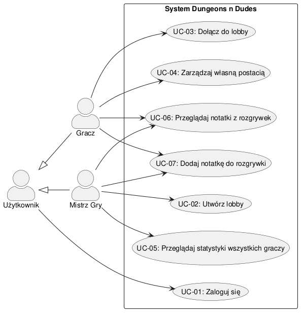

# Przypadki użycia — Dungeons n Dudes

Katalog zawiera analizę funkcjonalną systemu z perspektywy jego użytkowników: identyfikację aktorów, ich cele oraz sformalizowane scenariusze przypadków użycia.

---

## 1. Aktorzy systemu

| Aktor | Typ | Opis i cele |
| --- | --- | --- |
| **Użytkownik** | Aktor bazowy | Osoba posiadająca konto w systemie. Jej celem jest uwierzytelnienie się w celu uzyskania dostępu do dedykowanych funkcji. |
| **Gracz** | Specjalizacja *Użytkownika* | Uczestnik sesji RPG. Jego celem jest dołączanie do sesji, zarządzanie swoją postacią (karta postaci, statystyki, ekwipunek), wgląd w notatki |
| **Mistrz Gry** | Specjalizacja *Użytkownika* | Osoba prowadząca rozgrywkę. Jej celem jest organizacja sesji (tworzenie lobby), wgląd w pełny stan gry (statystyki wszystkich graczy) | |

---

## 2. Diagram przypadków użycia

Diagram został zdefiniowany w pliku [`use-cases.puml`](./use-cases.puml)

---

## 3. Zestawienie przypadków użycia

| ID | Nazwa przypadku użycia | Główny aktor | Powiązane wymagania |
| --- | --- | --- | --- |
| **UC-01** | Zaloguj się | Użytkownik | FR-06, NFR-01 |
| **UC-02** | Utwórz lobby | Mistrz Gry | FR-01 |
| **UC-03** | Dołącz do lobby | Gracz | FR-01 |
| **UC-04** | Zarządzaj własną postacią | Gracz | FR-03, FR-05 |
| **UC-05** | Przeglądaj statystyki wszystkich graczy | Mistrz Gry | FR-02 |
| **UC-06** | Przeglądaj notatki z rozgrywek | Gracz, Mistrz Gry | FR-04 |
| **UC-07** | Dodaj notatkę do rozgrywki | Gracz, Mistrz Gry | FR-07 |
